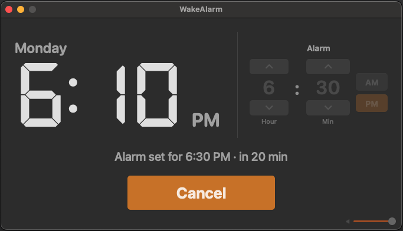

# WakeAlarm

A tiny local macOS alarm clock — same-day one-shot alarms, classic digital beep, gradual volume ramp (~30s), remembered volume. No App Store account, no login, no network.

**One use case:** never miss a work meeting again when you’re deep in the zone — set the alarm for 5 minutes before your next scheduled meeting and keep coding until it fires.



## Features

- Large digital clock (7-segment style) plus a simple alarm picker (hour / minute / AM·PM)
- Default alarm time is the top of the next hour (e.g. 6:41 → 7:00)
- Same-calendar-day alarms only (no “tomorrow”)
- Classic paired digital beep with a ~30s volume ramp
- Beep auto-stops after 15 minutes; green UI + Dock bounce continue until you stop
- Volume slider remembered across launches
- While armed, asks macOS not to idle-sleep
- Closing the window quits the app and cancels any armed or ringing alarm

## Requirements

- macOS 13 Ventura or later
- Xcode Command Line Tools (or full Xcode) so `swiftc` / `xcrun` are available

```bash
xcode-select --install   # if needed
```

## Build & run

```bash
./build.sh
open build/WakeAlarm.app
```

Optional universal binary (Apple Silicon + Intel):

```bash
./build.sh --universal
```

Smoke-check the bundle after building:

```bash
./smoke_test.sh
```

Drag `build/WakeAlarm.app` into `/Applications` if you want it in Launchpad / a persistent Dock icon.

## Usage

1. Set today’s alarm time with the steppers or by typing hour / minute.
2. Adjust volume once if needed (remembered next launch).
3. Click **Set Alarm** and leave the app running.
4. When it fires: Dock icon bounces, window turns green, beep ramps up — click **Stop Alarm**.
5. After 15 minutes the beep stops on its own; green UI + Dock bounce continue until you stop.

Closing the window quits the app and stops any armed or ringing alarm.

## Notes

- A time already past today cannot be set.
- If the Mac is fully powered off, the alarm will not fire.
- This is intentionally unsigned / ad-hoc signed for personal use. First open may require **Right-click → Open** (or System Settings → Privacy & Security) depending on Gatekeeper.

## Project layout

```
Sources/          SwiftUI app + alarm / audio logic
Resources/        Info.plist, AppIcon.icns, bundled DSEG font
build.sh          Compiles WakeAlarm.app into build/
smoke_test.sh     Verifies the built bundle
screenshot.png    UI preview for this README
```

## Credits

- **DSEG** 7-segment font by [keshikan](http://www.keshikan.net), licensed under the [SIL Open Font License 1.1](Resources/Fonts/DSEG-LICENSE.txt).

## License

WakeAlarm is released under the [MIT License](LICENSE).
